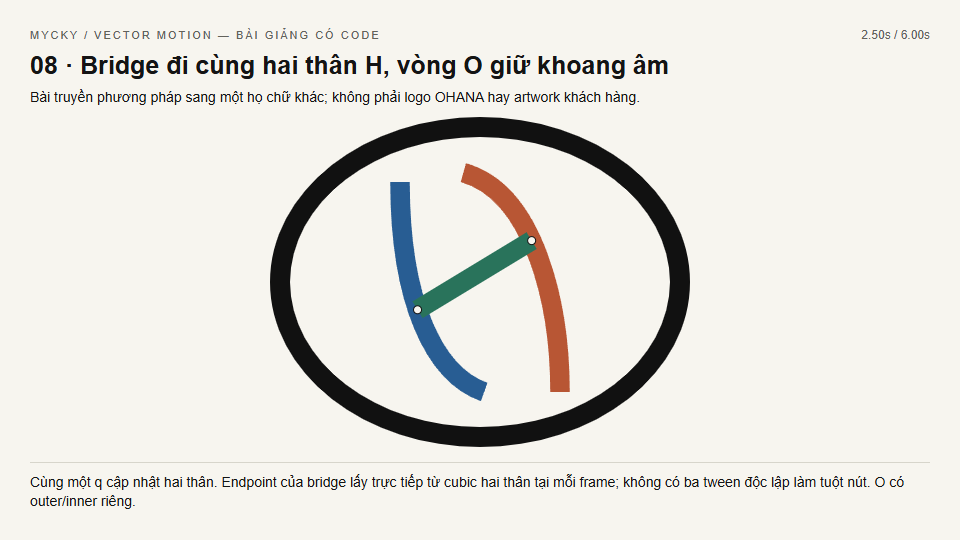

# Mycky Logo Motion

Skill Codex để phân tích logo và video mẫu, chọn cách biến chữ thường thành icon
có quan hệ hình học rõ, triển khai và tự kiểm tra chuyển động.

## Có gì trong skill?

- 42 cơ chế có thể kết hợp: thu nét, uốn bowl/đuôi, ghép trụ, đan chữ, vẽ cung,
  nhân bản, xoay/lật, lắp module, thu icon và hiện wordmark.
- Phân tích từ 15 video tổng hợp của [@mycky1508](https://www.tiktok.com/@mycky1508),
  khoảng 75 đoạn logo; có ảnh chứng cứ và timecode. Danh mục 189 link là metadata,
  không phải tuyên bố đã xem toàn bộ kênh.
- Chọn công thức theo anatomy, khoang âm, điểm nối và cấu trúc lặp của logo đích.
  Phương án sai artwork bị loại trước khi đánh giá nhịp/phong cách.
- Hướng dẫn semantic correspondence, arc-length, cubic Bézier, pivot, ownership,
  chống nét rời/răng cưa; giữ rõ thứ tự morph, clone và rotation.
- Công cụ local đo bbox/counter, tách frame, fit cubic tương ứng, kiểm quyết định,
  kiểm MP4 và tăng tốc kèm giữ logo cuối.

## Cài từ repository này

### Bản v2: học bằng hình, video và source chạy được

- **9 video kỹ thuật**: counter, đan chữ, clone, draw-on, radial, rút nét,
  placement, H/O giữ bridge và một chuỗi đầy đủ S → module → icon.
- **27 ảnh theo pha** và một atlas ca lỗi: nhận diện trụ gợn, phình nét, giao
  bệt; không nghiệm thu bằng frame cuối.
- **2 video tham chiếu thật** do user cung cấp: Sắc Son và Yến Chi. Học cơ chế/
  nhịp, không mượn hình dáng của chúng cho logo khác.
- Native SVG có thanh tua, debug màu, geometry core dùng chung và scene
  Motion Canvas 3.17.2 minh họa compound path với winding đúng.
- Kiểm browser trên chính cubic/path: B giữ hai khoang ở 101 trạng thái;
  H giữ bridge liền ở 101 trạng thái; seek ngược/xuôi tái lập cùng frame.



[Đọc visual playbook](skills/mycky-logo-motion/references/visual-playbook.md)
· [Video S → module → icon](skills/mycky-logo-motion/assets/lessons/sassembly.mp4)
· [Video giữ hai khoang B](skills/mycky-logo-motion/assets/lessons/counter.mp4)
· [Video Sắc Son tham chiếu](skills/mycky-logo-motion/assets/lessons/references/sac-son-reference.mp4)

Để tua tương tác: tải repository rồi mở
`skills/mycky-logo-motion/references/visual-lessons.html` trong Chrome. GitHub
hiển thị source HTML; không chạy phòng thí nghiệm ngay trong trang repository.
Các ví dụ hình học là bài học có code, không phải logo đích cho mọi khách.

### Cài skill

Sao chép URL thật của repository hoặc đường dẫn
`skills/mycky-logo-motion`, rồi yêu cầu Codex:

> Dùng $skill-installer cài skill mycky-logo-motion từ repository này,
> đường dẫn skills/mycky-logo-motion. Lưu trên ổ D nếu máy có ổ D.

Hoặc tải Code → Download ZIP, giải nén và đưa thư mục
`skills/mycky-logo-motion` vào thư mục skill của Codex. Giữ cả `SKILL.md`,
`scripts/`, `references/`, `assets/` và `agents/`. Nếu skill đã tồn tại, không
ghi đè bản tùy chỉnh mà chưa xem khác biệt.

Hướng dẫn chính thức: [OpenAI Skills](https://developers.openai.com/plugins/build/skills).

## Dùng sau khi cài

Gửi logo nguồn, artwork icon/wordmark chuẩn và video mẫu nếu có, rồi viết:

> Dùng $mycky-logo-motion. Phân tích logo, tự chọn công thức phù hợp nhất,
> triển khai và render thử đoạn morph trước khi xuất video hoàn chỉnh.

Brief đã khóa concept thì skill giữ nguyên concept; chỉ tối ưu mapping, geometry
và nhịp. Có thể yêu cầu 3–5 phương án nếu artwork thực sự cho phép, hoặc giao
Codex tự chọn. Không buộc logo nào cũng quay hoặc nhân thành bốn cánh.

## Công cụ đo và kiểm tra (tùy chọn)

Phần hướng dẫn dùng được độc lập. Các helper cần Python với NumPy, Pillow,
OpenCV; các lệnh video cần FFmpeg/FFprobe có sẵn. Skill không tự cài dependency
hoặc cài lại Motion Canvas. `requirements.txt` ghi các dependency nếu cần chuẩn bị
một môi trường mới theo yêu cầu riêng.

PowerShell, tại thư mục skill:

```powershell
& ./scripts/run.ps1 doctor
& ./scripts/run.ps1 logo 'D:/input/logo.png' --out 'D:/job/logo-analysis'
& ./scripts/run.ps1 reference 'D:/input/sample.mp4' --out 'D:/job/review' --sample-fps 2
& ./scripts/run.ps1 select 'D:/job/candidates.json' --out 'D:/job/decision.json'
python ./scripts/self_test.py
```

Trên hệ điều hành khác dùng `python scripts/logo_lab.py ...`. Nếu runtime có
dependency riêng, sao chép `runtime.example.json` thành `runtime.local.json`,
đổi thành đường dẫn có thật. Hoặc dùng `MYCKY_PYTHON`, `MYCKY_PYTHON_DEPS`,
`MYCKY_FFMPEG`, `MYCKY_FFPROBE`. Thư mục `scratch_root` phải tồn tại. Không đưa
runtime local, token, file video khách hàng hay project riêng lên GitHub.

## Giới hạn

Đây là hướng dẫn và công cụ hỗ trợ Codex, không phải mô hình AI nhận dạng logo
mới. Codex vẫn phải xem artwork, gán mốc đúng nghĩa, kiểm frame và playback.
Điểm số là đánh giá có chứng cứ, không chứng minh tối ưu tuyệt đối. Kiểm codec
đạt không có nghĩa morph đã đẹp. Ví dụ B đi kèm là bài học mapping, không phải
template hình dạng cho logo khác. Artwork/logo nghiên cứu giữ quyền của chủ sở
hữu; không lấy logo trong chứng cứ thay artwork của dự án mới.
